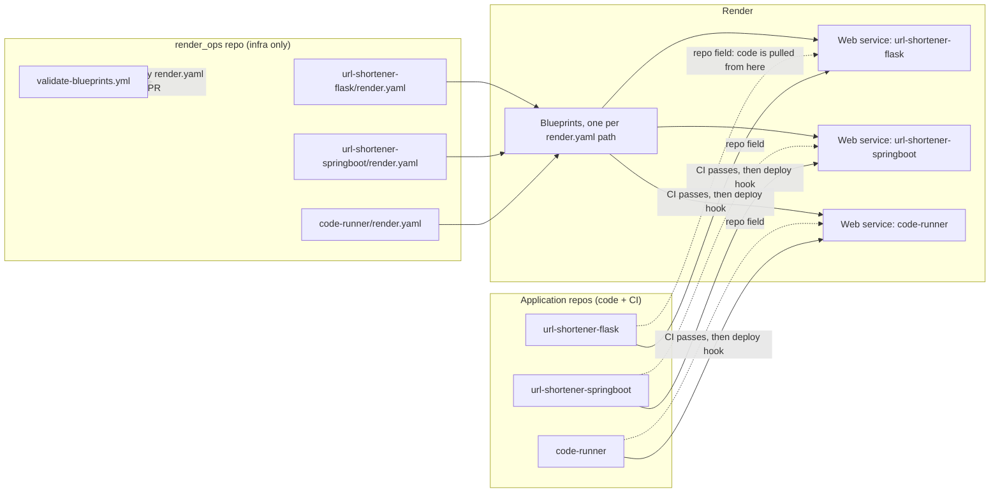
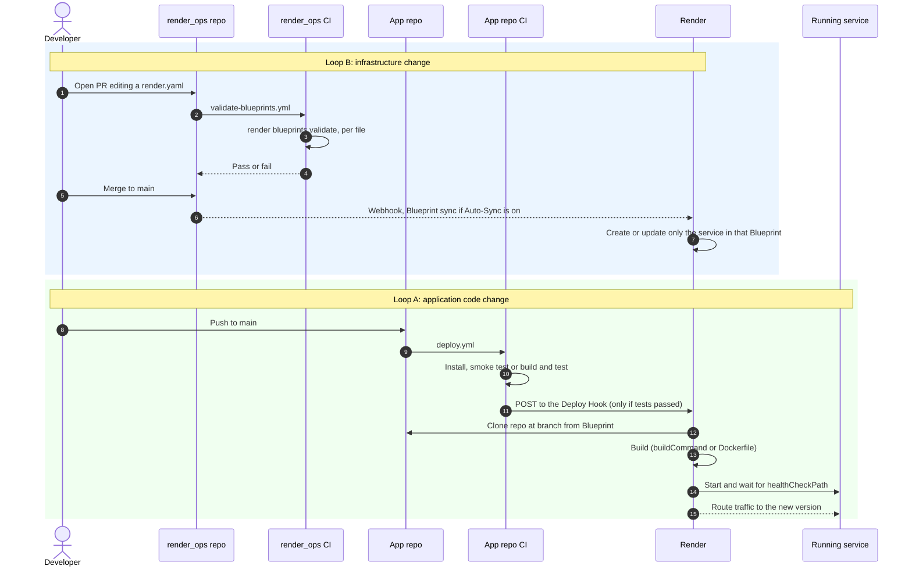

# render_ops — How One Repo Deploys Every API on Render

`render_ops` is an **infrastructure-only** repo. It holds one Render Blueprint (`render.yaml`) per
application, and contains no application code. Each application (Flask URL shortener, Spring Boot
URL shortener, code runner, and so on) lives in its **own** GitHub repo with its own tests and its
own CI. This guide explains how the pieces connect, how a deploy actually happens, and how to add
a new API.

---

## 1. The big picture



Two separate things are kept apart on purpose:

| Concern | Lives in | Changes when you... |
|---|---|---|
| **What infrastructure exists** (plan, region, env vars, start command) | `render_ops` | change a setting, add a service, upgrade a plan |
| **What code runs on it** | each app's own repo | change application logic |

---

## 2. Repo layout

```
render_ops/
├── url-shortener-flask/
│   └── render.yaml
├── url-shortener-springboot/
│   └── render.yaml
├── code-runner/
│   └── render.yaml
├── .github/
│   └── workflows/
│       └── validate-blueprints.yml
└── RENDER_OPS_GUIDE.md        # this file
```

**One folder per application, one `render.yaml` per folder.** Each one becomes its own Blueprint in
Render, so a bad edit to one API's config can only re-sync that one API.

---

## 3. Why this works: two Render features

1. **Blueprints accept a custom file path.** `render.yaml` doesn't have to sit at the repo root.
   When you create a Blueprint in the Dashboard you point it at `url-shortener-flask/render.yaml`
   (or any other path) inside `render_ops`.
2. **Every service has a `repo` field.** It defaults to the repo that contains the `render.yaml`,
   but you can set it to any repo. That is what lets a Blueprint stored in `render_ops` build code
   that lives in a completely different repository.

---

## 4. What each `render.yaml` looks like

Python service (`url-shortener-flask/render.yaml`):

```yaml
services:
  - type: web
    name: url-shortener-flask
    runtime: python
    repo: https://github.com/<your-org>/url-shortener-flask   # code lives here
    branch: main
    plan: free
    region: oregon
    buildCommand: "pip install -r requirements.txt"
    startCommand: "gunicorn app:app --bind 0.0.0.0:$PORT"
    healthCheckPath: /
    autoDeploy: false          # deploys come from the app repo's GitHub Action
    envVars:
      - key: PYTHON_VERSION
        value: 3.11.9
```

Docker service (`url-shortener-springboot/render.yaml`):

```yaml
services:
  - type: web
    name: url-shortener-springboot
    runtime: docker
    repo: https://github.com/<your-org>/url-shortener-springboot
    branch: main
    plan: free
    region: oregon
    dockerfilePath: ./Dockerfile
    dockerContext: .
    healthCheckPath: /
    autoDeploy: false
```

Key fields:

| Field | Purpose |
|---|---|
| `repo` / `branch` | Where Render pulls application code from, not `render_ops` |
| `runtime` | `python`, `node`, or `docker` (Java goes through `docker`) |
| `plan` | `free` for demos; paid plans for always-on and scaling |
| `healthCheckPath` | Render waits for this to return success before routing traffic |
| `autoDeploy: false` | Render does **not** deploy on every push, so CI can gate deploys |

---

## 5. How a deploy happens (sequence)



### Loop A: application code changes (lives in each app repo)

1. Push to the app repo's `main`.
2. Its `.github/workflows/deploy.yml` installs dependencies and runs tests (a syntax or import
   smoke test for the Python and Node apps, `mvn package` for Spring Boot).
3. Only if that job passes, a second job `curl`s the service's **Deploy Hook** URL, stored as the
   repo secret `RENDER_DEPLOY_HOOK_URL`.
4. Render clones the repo at the branch named in the Blueprint, builds, health-checks, and
   switches traffic over.

A failing test stops the pipeline before the deploy hook is called, so broken code never ships.
That is the reason for `autoDeploy: false`: with auto-deploy on, Render would deploy on push
regardless of whether CI passed.

### Loop B: infrastructure changes (lives in `render_ops`)

1. Edit a `render.yaml` (new env var, plan upgrade, new service) and open a PR.
2. `validate-blueprints.yml` runs `render blueprints validate` on every `render.yaml` in the repo,
   catching schema typos, bad enum values, and broken references before merge.
3. Merge to `main`. Render applies the change to that one Blueprint's service. This relies on the
   Blueprint's **Auto-Sync** setting being enabled in the Dashboard; if you turned it off, trigger
   a manual sync from the Blueprint's page instead.

---

## 6. The validation workflow

`.github/workflows/validate-blueprints.yml`:

```yaml
name: Validate Render Blueprints

on:
  pull_request:
    paths:
      - "**/render.yaml"
      - ".github/workflows/validate-blueprints.yml"
  push:
    branches: [main]
    paths:
      - "**/render.yaml"

jobs:
  validate:
    name: Validate each render.yaml
    runs-on: ubuntu-latest
    steps:
      - name: Checkout code
        uses: actions/checkout@v4

      - name: Install the Render CLI
        run: |
          curl -fsSL https://raw.githubusercontent.com/render-oss/cli/main/bin/install.sh | sh
          echo "$HOME/.render/bin" >> "$GITHUB_PATH"

      - name: Validate every render.yaml in the repo
        run: |
          status=0
          for f in $(find . -name "render.yaml" -not -path "./node_modules/*"); do
            echo "== Validating $f =="
            render blueprints validate "$f" || status=1
          done
          exit $status
```

It only triggers when a `render.yaml` changes, loops over every one, and fails the check if any
single file is invalid. You can run the same check locally:

```bash
render blueprints validate url-shortener-flask/render.yaml
```

> If the installer URL or command changes in a future CLI release, check Render's CLI docs. The
> check itself is a static schema validation and doesn't modify any live resources.

---

## 7. Adding a new API (checklist)

Say you are adding `chat-video`:

1. **Create the app repo** (`chat-video`) with its code and its own
   `.github/workflows/deploy.yml` (test job, then a deploy-hook job). Do **not** put a
   `render.yaml` in it.
2. **Add a folder to `render_ops`:** `chat-video/render.yaml`, with `repo:` pointing at the new
   app repo and `autoDeploy: false`.
3. **Open a PR** to `render_ops` and let the validation check pass, then merge.
4. **Create the Blueprint in Render (one-time, in the Dashboard):**
   **New → Blueprint** → connect `render_ops` → set the Blueprint file path to
   `chat-video/render.yaml` → **Apply**.
5. **Grant GitHub access:** Render's GitHub App must be able to read both `render_ops` (for the
   Blueprint) and the new app repo (for the code `repo:` points at).
6. **Wire up the deploy hook:** copy the new service's Deploy Hook
   (Settings → Deploy Hook) into the app repo as a secret:

   ```bash
   gh secret set RENDER_DEPLOY_HOOK_URL --repo <your-org>/chat-video --body '<hook-url>'
   ```

7. **Push to the app repo's `main`.** Loop A now takes over for every future code change.

Step 4 is the only manual step per API. After that, both loops run on their own.

---

## 8. Optional: adding a managed data store

If a service later needs Redis-compatible storage, add a `keyvalue` entry to that API's
`render.yaml`. On the free plan it is in-memory only (a restart clears it) and limited to one
instance per workspace:

```yaml
  - type: keyvalue
    name: url-shortener-cache
    plan: free
    ipAllowList: []          # private to your Render services
```

Free Postgres exists too, but free databases expire after a limited period (30 days at the time
of writing), so treat them as temporary.

---

## 9. Troubleshooting

| Symptom | Likely cause |
|---|---|
| Blueprint creation says the repo can't be found or built | Render's GitHub App lacks access to the app repo named in `repo:` |
| Code pushed but nothing deployed | `RENDER_DEPLOY_HOOK_URL` secret missing or wrong, or the test job failed first |
| Deployed on every push, ignoring CI | `autoDeploy` is `true` in that `render.yaml` |
| `render.yaml` change merged but service unchanged | Auto-Sync is off for that Blueprint, so sync manually from its page |
| Validation job fails on a PR | Run `render blueprints validate <file>` locally to see the schema error |
| First request is slow on the free plan | Free services spin down after about 15 minutes idle and cold-start on the next request |

---

## 10. Summary

- **`render_ops`** = declarations of infrastructure, one `render.yaml` per app, validated on every
  PR.
- **App repos** = code, tests, and a deploy-hook workflow, with no infrastructure files.
- **Render Blueprint** = the bridge: it lives at a path inside `render_ops` but its `repo:` field
  points at the app repo.
- **Two independent loops:** infra changes flow through validation then Blueprint sync, and code
  changes flow through CI then a deploy hook.